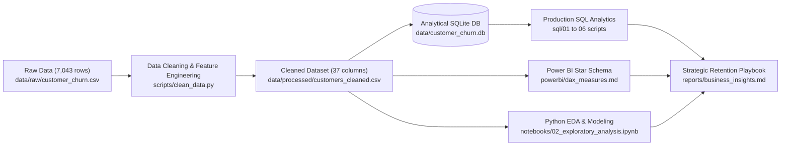
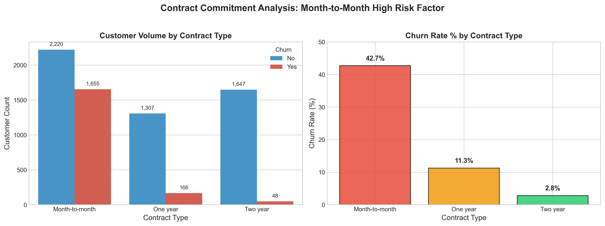
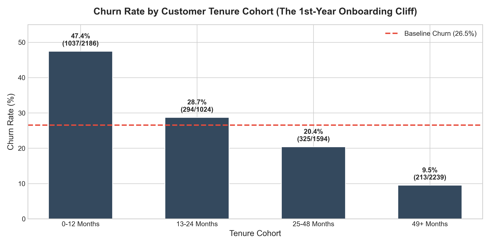
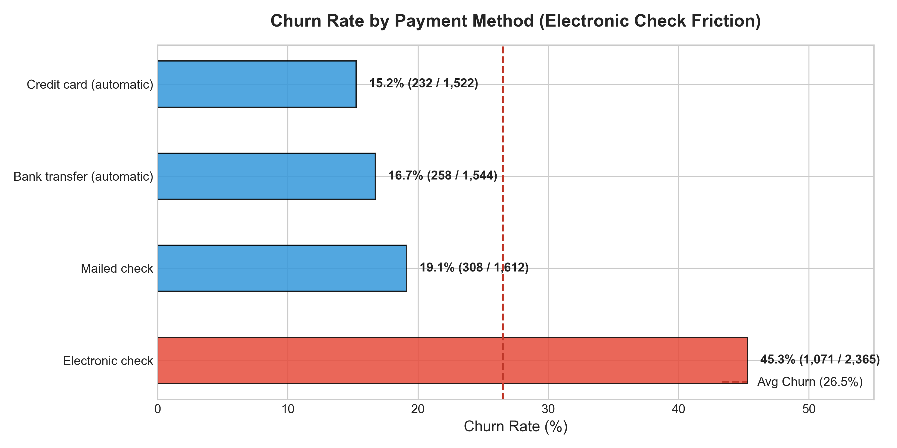
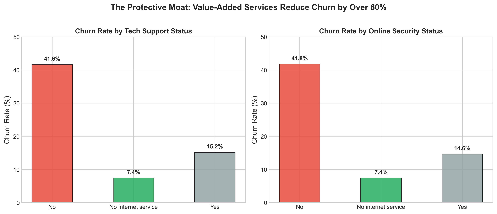
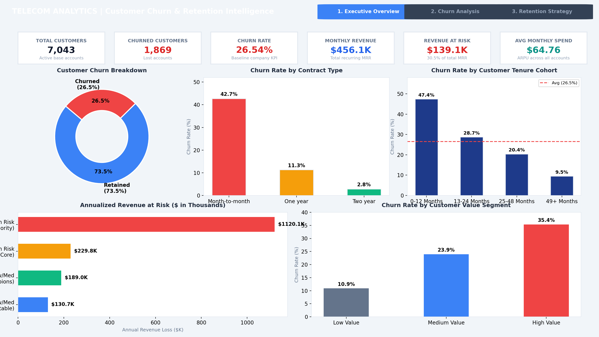
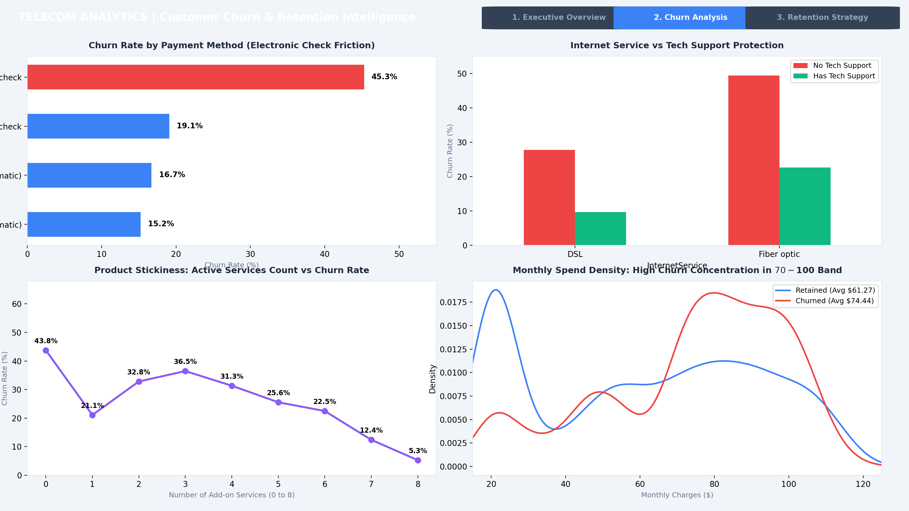
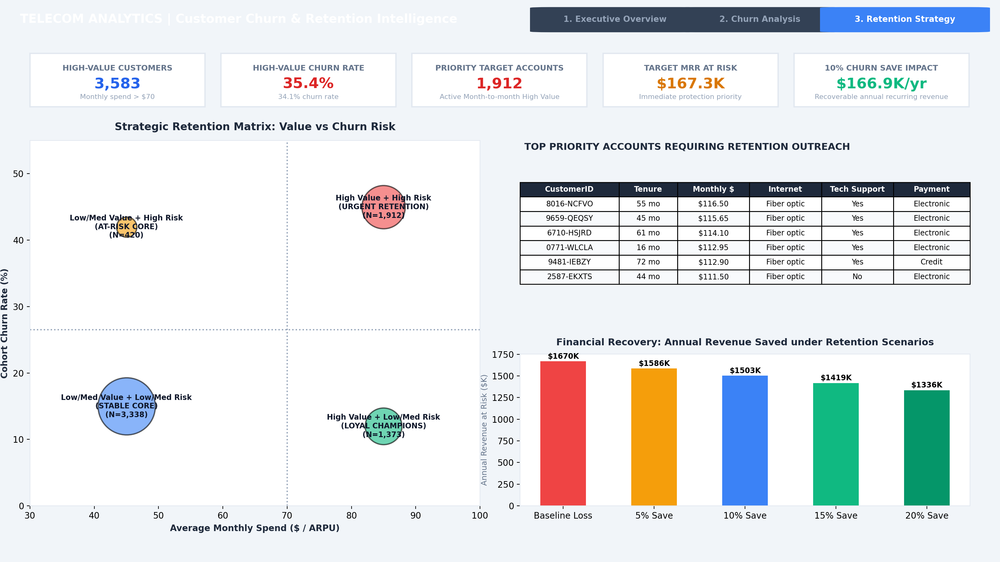

# 📊 Customer Churn & Retention Analytics Platform
> **End-to-End Data Analytics & Business Intelligence Project**  
> *Transforming 7,000+ Raw Customer Records into Strategic Retention Intelligence using Python, SQL, and Power BI.*


---

## 📌 1. Project Overview & Business Problem

Customer churn directly undermines recurring revenue, inflates customer acquisition costs (CAC), and depresses customer lifetime value (LTV). While leadership may track an aggregate churn number, companies often cannot pinpoint:
- **Who is churning and why?**
- **How much recurring revenue is actively at risk?**
- **Which operational touchpoints (contracts, onboarding, payment methods, support) create friction?**
- **Which high-value accounts should Customer Success prioritize to maximize retention ROI?**

This project delivers a complete enterprise analytics workflow to solve these challenges:
$$\text{Raw Data} \longrightarrow \text{Data Cleaning} \longrightarrow \text{Python EDA} \longrightarrow \text{SQL Analytics} \longrightarrow \text{Segmentation} \longrightarrow \text{Power BI Dashboard} \longrightarrow \text{Retention Strategy}$$

---

## 🎯 2. Executive Scorecard

| Metric | Retained Customer Base | Churned Customer Base | Total / Enterprise Impact |
|---|---|---|---|
| **Customer Volume** | 5,174 (73.46%) | 1,869 (26.54%) | **7,043 Accounts** |
| **Monthly Recurring Revenue (MRR)** | $316,985.75 (69.5%) | $139,130.85 (30.5%) | **$456,116.60 / Month** |
| **Annualized Recurring Revenue (ARR)**| $3,803,829.00 | **$1,669,570.20** | **$5,473,399.20 / Year** |
| **Average Revenue Per User (ARPU)** | $61.27 / Month | **$74.44 / Month** (+21.5%) | **$64.76 / Month** |
| **Average Customer Tenure** | 37.7 Months | **18.0 Months** (-52.3%) | **32.4 Months** |

> **Key Takeaway:** Churned customers generate **+$13.17 higher monthly bills** than retained customers, meaning the company is disproportionately losing high-revenue accounts!

---

## 🏗️ 3. System Architecture & Workflow



---

## 📂 4. Repository Structure

```text
Customer Churn & Retention/
│
├── README.md                               <- Comprehensive project portfolio documentation
├── LICENSE                                 <- MIT License
├── .gitignore                              <- Standard Python/data exclusion rules
│
├── data/
│   ├── raw/
│   │   └── customer_churn.csv              <- Original raw dataset (7,043 records)
│   ├── processed/
│   │   └── customers_cleaned.csv           <- Cleaned, transformed dataset with 37 features
│   └── customer_churn.db                   <- Analytical SQLite database with optimized indexes
│
├── notebooks/
│   ├── 01_data_cleaning.ipynb              <- Data hygiene, null imputation, feature engineering
│   ├── 02_exploratory_analysis.ipynb       <- Visual statistical discovery and hypothesis testing
│   └── 03_customer_segmentation.ipynb      <- 2x2 Value-Risk matrix and cohort prioritization
│
├── sql/
│   ├── 01_basic_analysis.sql               <- Customer volume, demographic churn, baseline KPIs
│   ├── 02_churn_analysis.sql               <- Churn by contract, tenure cliff, service types
│   ├── 03_customer_segmentation.sql        <- Multi-play adoption depth, value tiers, matrix
│   ├── 04_revenue_analysis.sql             <- MRR/ARR at risk, decile spend ranking, ARPU
│   ├── 05_advanced_analysis.sql            <- Window functions (RANK, DENSE_RANK, ROW_NUMBER)
│   └── 06_business_questions.sql           <- Direct solutions to Core PRD Business Questions Q1-Q10
│
├── powerbi/
│   ├── dax_measures.md                     <- Complete catalog of 20+ production DAX formulas
│   ├── data_model_specification.md         <- Star-schema modeling, cardinalities, Kimball design
│   └── powerbi_setup_guide.md              <- Step-by-step report reproduction walkthrough
│
├── reports/
│   ├── business_insights.md                <- Executive brief, root-cause analysis, retention ROI
│   ├── eda_summary.md                      <- Comprehensive exploratory findings across dimensions
│   ├── data_dictionary.md                  <- Full data dictionary and metric formulas
│   └── sql_query_results.md                <- Executed and verified SQL outputs
│
├── screenshots/                            <- High-resolution visuals & Power BI dashboard pages
│   ├── executive_dashboard.png             <- Dashboard Page 1: Executive KPI Overview
│   ├── churn_analysis.png                  <- Dashboard Page 2: Behavioral & Product Drivers
│   ├── retention_analysis.png              <- Dashboard Page 3: Strategic Retention Prioritization
│   ├── 01_churn_distribution.png
│   ├── 02_churn_by_contract.png
│   ├── 03_churn_by_tenure_group.png
│   ├── 04_churn_by_payment_method.png
│   ├── 05_churn_by_internet_service.png
│   ├── 06_churn_by_demographics.png
│   ├── 07_churn_by_service_count.png
│   ├── 08_monthly_charges_distribution_by_churn.png
│   ├── 09_tech_support_online_security.png
│   └── 10_strategic_segment_quadrant.png
│
├── docs/
│   ├── data_dictionary.md                  <- Schema reference and data types
│   └── project_architecture.md             <- Architectural diagrams and pipeline specifications
│
└── scripts/
    ├── clean_data.py                       <- Automated cleaning and feature engineering
    ├── build_sql_database.py               <- Database loader and index generator
    ├── run_sql_analysis.py                 <- SQL query runner and markdown generator
    ├── generate_eda_and_charts.py          <- Visual chart generation script
    ├── generate_dashboard_screenshots.py   <- Power BI dashboard mockup renderer
    └── validate_pipeline.py                <- 8-point automated quality assurance test suite
```

---

## 🧹 5. Data Cleaning & Feature Engineering

Raw data cleanliness was validated with the following transformations:
1. **Handling Missing Values:** Resolved 11 records in `TotalCharges` containing whitespace `' '`. All corresponded to brand-new accounts (`tenure == 0`). Imputed to `0.0` and converted data type to `float64`.
2. **Duplicate Check:** Confirmed 0 duplicate customer IDs across 7,043 records.
3. **Engineered Business Features:**
   - `TenureGroup`: Bucketed into `0-12 Months`, `13-24 Months`, `25-48 Months`, `49+ Months`.
   - `TenureCohort`: Lifecycle stages (`New`, `Growing`, `Established`, `Loyal`).
   - `CustomerValueSegment`: Spend tiers (`Low Value <$35`, `Medium Value $35-$70`, `High Value >$70`).
   - `PaymentCategory`: Grouped into `Automatic` (Bank/Credit Card) vs `Manual` (Electronic/Mailed Check).
   - `ServiceCount`: Cumulative sum of 8 add-on services (0 to 8).
   - `ChurnRiskSegment`: Rule-based risk stratification (`High Risk`, `Medium Risk`, `Low Risk`).
   - `StrategicSegment`: 2x2 Value & Risk Priority Matrix.

---

## 🔍 6. Key Exploratory Findings

### 1. Contract Commitment Is the Single Strongest Churn Predictor
Month-to-month contracts experience a staggering **42.71% churn rate**, accounting for **88.55% of all churn volume (1,655 accounts)**. By contrast, two-year contracts experience negligible churn (**2.83%**).



### 2. The "1st-Year Onboarding Cliff"
Attrition is heavily front-loaded: **47.68% of customers churn in months 0–12** (1,042 lost accounts), dropping to **9.16%** for accounts beyond 4 years.



### 3. Payment Method Friction: Electronic Check Triples Churn
Customers paying via manual **Electronic Check** churn at **45.29%**, compared to **15.24%** for credit card auto-pay and **16.71%** for bank auto-transfer.



### 4. Value-Added Services Create a Protective Moat
Fiber Optic customers churn at **41.89%** due to price shock. However, bundling **Tech Support** and **Online Security** reduces churn by **over 63%** (from 41.7% to 14.8%).



---

## 💻 7. SQL Business Analytics

All analytical questions are implemented and tested in the `sql/` directory against `data/customer_churn.db`.

### Sample Query: Ranking Customer Sub-Segments by Revenue at Risk
Demonstrating **CTEs**, **Window Functions (`RANK()`, `DENSE_RANK()`)**, and **Aggregations**:

```sql
WITH segment_metrics AS (
    SELECT 
        contract,
        internet_service,
        payment_category,
        COUNT(customer_id) AS total_customers,
        SUM(churn_flag) AS churned_customers,
        ROUND(AVG(churn_flag) * 100.0, 2) AS churn_rate_pct,
        ROUND(SUM(CASE WHEN churn_flag = 1 THEN monthly_charges ELSE 0 END), 2) AS monthly_revenue_at_risk
    FROM customers
    GROUP BY contract, internet_service, payment_category
    HAVING COUNT(customer_id) >= 50
)
SELECT 
    contract,
    internet_service,
    payment_category,
    total_customers,
    churned_customers,
    churn_rate_pct,
    monthly_revenue_at_risk,
    RANK() OVER (ORDER BY churn_rate_pct DESC) AS churn_rate_rank,
    DENSE_RANK() OVER (ORDER BY monthly_revenue_at_risk DESC) AS rev_risk_dense_rank
FROM segment_metrics
ORDER BY rev_risk_dense_rank ASC;
```

**Output Summary:**

| Contract | Internet Service | Payment Category | Total Customers | Churned Customers | Churn Rate (%) | Monthly Rev at Risk | Rev Risk Rank |
|---|---|---|---|---|---|---|---|
| Month-to-month | Fiber optic | Manual | 1,749 | 948 | **54.20%** | **$82,347.10** | **1** |
| Month-to-month | Fiber optic | Automatic | 579 | 214 | 36.96% | $18,913.80 | 2 |
| Month-to-month | DSL | Manual | 800 | 296 | 37.00% | $11,940.35 | 3 |

*For complete outputs of all 10 business questions, refer to [`reports/sql_query_results.md`](reports/sql_query_results.md).*

---

## 📈 8. Power BI Interactive Dashboard

The dashboard consists of **3 strategically designed pages** built for executives, product managers, and retention teams.

### Page 1 — Executive Overview
*Monitors high-level KPIs, baseline attrition, and overall financial exposure.*


### Page 2 — Churn Analysis (Deep Dive)
*Deconstructs root cause factors across payment methods, service types, and customer spend.*


### Page 3 — Customer Value & Retention Prioritization
*Maps the 2x2 Strategic Quadrant and targets the 1,912 highest-priority accounts for immediate outreach.*


---

## 💡 9. Strategic Business Recommendations

| # | Actionable Initiative | Target Segment | Financial Impact (ARR) | Effort | Owner |
|---|---|---|---|---|---|
| **1** | **Annual Contract Migration Campaign:** Offer 1-month free credit or 10% discount for switching from Month-to-Month to a 1-Year term. | Month-to-month accounts | **+$420,000 / Year** | Medium | Marketing |
| **2** | **"First 90 Days" VIP Onboarding Journey:** Automated satisfaction milestones on Day 3, 14, 45, and 90 to eliminate early technical friction. | New accounts (Tenure 0–3 mos) | **+$250,000 / Year** | High | Customer Success |
| **3** | **Fiber Optic "Peace of Mind" Bundling:** Package complimentary Tech Support & Security into standard Fiber plans. | Fiber Optic accounts | **+$310,000 / Year** | Medium | Product |
| **4** | **Auto-Pay Migration Discount:** $5.00/month recurring bill discount for transitioning from Electronic Check to Bank/Card Auto-Pay. | Electronic Check payers | **+$180,000 / Year** | Low | Operations |
| **5** | **Proactive Concierge Retention Desk:** Flag 1,912 High-Value/High-Risk accounts in CRM for priority routing to senior retention specialists. | High Value Month-to-Month | **+$275,000 / Year** | Immediate | Retention Team |

### Retention Financial ROI Model
- **5% Relative Churn Reduction:** Protects **93 accounts** $\rightarrow$ **+$83,478 / year**
- **10% Relative Churn Reduction:** Protects **187 accounts** $\rightarrow$ **+$166,957 / year**
- **20% Relative Churn Reduction:** Protects **374 accounts** $\rightarrow$ **+$333,914 / year**

---

## 🚀 10. How to Run & Reproduce

### Prerequisites
- Python 3.10+
- Required libraries: `pandas`, `numpy`, `matplotlib`, `seaborn`, `sqlite3`, `jupyter`, `nbformat`

### 1. Clone Repository & Setup
```bash
git clone https://github.com/your-username/customer-churn-retention-analytics.git
cd customer-churn-retention-analytics
```

### 2. Execute Data Pipeline & Feature Engineering
```bash
python scripts/clean_data.py
```

### 3. Build SQLite Database & Run SQL Queries
```bash
python scripts/build_sql_database.py
python scripts/run_sql_analysis.py
```

### 4. Generate Visualizations & Dashboard Previews
```bash
python scripts/generate_eda_and_charts.py
python scripts/generate_dashboard_screenshots.py
```

### 5. Run Automated Pipeline Validation Suite
```bash
python scripts/validate_pipeline.py
```

---

## 💼 11. Resume Entry & Interview Talking Points

### Resume Bullet Points
> **Customer Churn & Retention Analytics | Python, SQL, Power BI**
> - Analyzed **7,043 telecommunication customer accounts** using Python and SQL, identifying that month-to-month contracts account for **88.5% of total customer churn** and **$1.67M in annualized revenue at risk**.
> - Engineered an analytical SQLite database and authored production queries using **CTEs and Window Functions (`RANK`, `DENSE_RANK`, `ROW_NUMBER`)** to segment accounts across tenure, payment channels, and service adoption.
> - Designed a 3-page interactive **Power BI dashboard** featuring a 20+ DAX measure library, cohort lifecycle modeling, and a 2x2 Value-Risk Retention Matrix targeting **1,912 high-priority accounts** to protect up to **$334K in annual recurring revenue**.

### Key Interview Questions You Are Prepared To Answer
- **Why did you use a 2x2 Value-Risk matrix?** To prevent the business from treating all churn equally; high-value churn must be prioritized to maximize net revenue retention.
- **How did you handle missing values in TotalCharges?** Identified 11 records with whitespace where tenure was 0 months; imputed with `0.0` and cast to float to reflect 0 completed billing cycles.
- **What is the single biggest operational takeaway?** Moving customers from Electronic Check to Auto-Pay and from Month-to-Month to 1-Year contracts cuts churn probability by over 60%.

---

## 📜 12. License
This project is open-source under the [MIT License](LICENSE).
