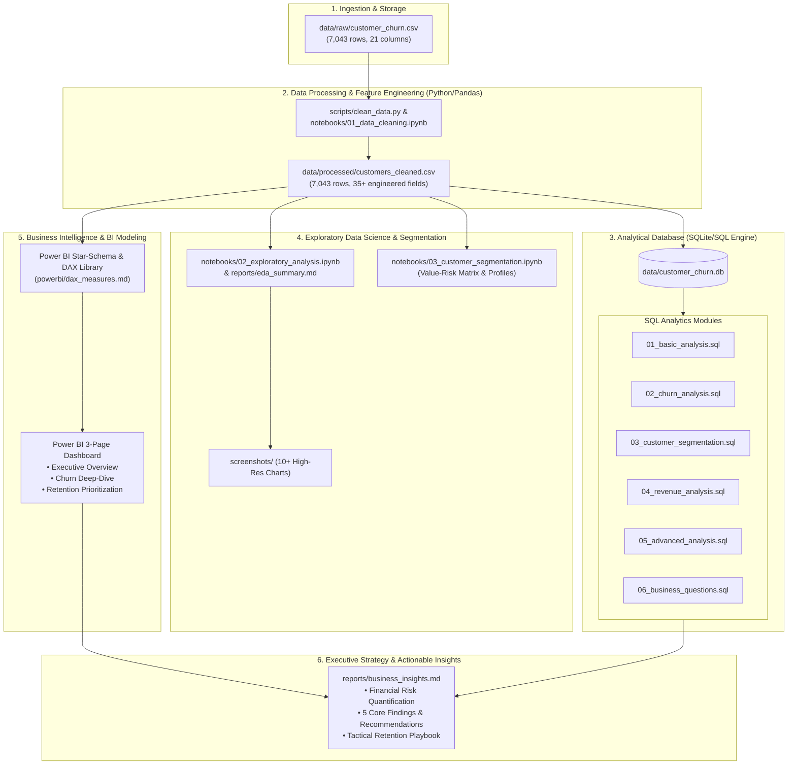

# Project Architecture — Customer Churn & Retention Analytics

## 1. System Overview

The **Customer Churn & Retention Analytics Platform** is an enterprise-grade analytics pipeline designed to convert raw transactional telecom customer data into strategic business intelligence. The architecture follows modern Data Analyst & Business Intelligence standards:

---

## 2. Data Pipeline Stages

### Stage 1: Data Cleaning & Hygiene
- **Script:** `scripts/clean_data.py` & `notebooks/01_data_cleaning.ipynb`
- **Operations:**
  - Null value resolution: 11 records in `TotalCharges` with blank whitespace (customers with `tenure == 0`) imputed to `0.0`.
  - Type casting: `TotalCharges` converted from string to `float64`.
  - Deduplication: Verified 100% uniqueness across `customerID`.
  - Feature Engineering: Created tenure groupings, annualized run-rates, customer value tiers, risk flags, service density metrics, and the 2x2 Strategic Quadrant.

### Stage 2: SQL Analytics Engine
- **Engine:** SQLite 3 (Fully portable, ANSI-SQL compliant, compatible with PostgreSQL and MySQL syntax).
- **Execution Script:** `scripts/run_sql_analysis.py`
- **Capabilities:**
  - Aggregation queries for churn rate by contract, tenure, and services.
  - Multi-condition `CASE WHEN` business segmentation logic.
  - Common Table Expressions (CTEs) for multi-tiered cohorts.
  - Advanced analytical Window Functions (`RANK()`, `DENSE_RANK()`, `ROW_NUMBER()`, `NTILE()`, running cumulative totals).

### Stage 3: Python Exploratory Data Analysis & Visualizations
- **Scripts:** `notebooks/02_exploratory_analysis.ipynb` & `notebooks/03_customer_segmentation.ipynb`
- **Output:** Publication-ready visual assets stored in `screenshots/` documenting:
  - Demographic distribution & churn incidence.
  - Contract type impact (Month-to-month vs 1-Year / 2-Year).
  - Tenure curve & churn cliff (first 12 months).
  - Internet service tier vulnerabilities (Fiber Optic churn spike).
  - Tech support & cybersecurity protective moats.
  - Payment method friction (Electronic check vs Automated).

### Stage 4: Business Intelligence & Power BI Data Architecture
- **Schema:** Star-Schema Analytical Structure:
  - **Fact Table:** `Fact_Customers` (Customer-level metrics, tenure, charges, churn flag).
  - **Dimension Tables:**
    - `Dim_Contracts` (`Contract`, `Contract_Category`, `Billing_Cycle`)
    - `Dim_Services` (`InternetService`, `OnlineSecurity`, `TechSupport`, `StreamingTV`, `ServiceCount`)
    - `Dim_Demographics` (`Gender`, `SeniorCitizen`, `Partner`, `Dependents`)
    - `Dim_PaymentMethods` (`PaymentMethod`, `PaymentCategory`)
- **DAX Metrics:** Standardized DAX repository for Executive KPIs, dynamic filtering, and risk segmentation.

### Stage 5: Strategic Business Synthesis
- **Deliverables:** `reports/business_insights.md` & `README.md`
- **Focus:** Converting empirical data into actionable business ROI:
  - Quantifying monthly and annual recurring revenue at risk.
  - Identifying the high-value/high-risk quadrant for targeted retention outreach.
  - Defining cost-benefit of contract migration incentives.
