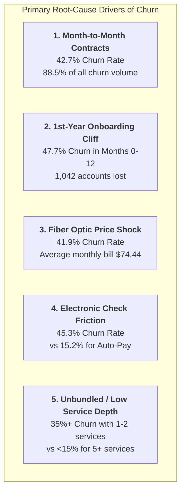

# Strategic Business Insights & Customer Retention Playbook

**Platform:** Customer Churn & Retention Analytics Platform  
**Target Audience:** Executive Leadership, VP of Customer Success, CMO, VP of Finance  
**Scope:** 7,043 Customer Accounts | $456,116 Monthly Recurring Revenue (MRR)  
**Author:** Lead Analytics Consultant  

---

## 1. Executive Summary

This strategic assessment synthesizes empirical findings across **7,043 telecommunication accounts** to identify the primary structural and behavioral root causes of customer churn. 

Our baseline analysis reveals an overall **churn rate of 26.54%** (1,869 churned accounts), representing **$139,130.85 in monthly lost recurring revenue** and **$1,669,570.20 in annualized lost revenue (ARR)**. Crucially, churn is not random: **88.5% of all cancellations originate from month-to-month contracts**, and **over 55% occur within the first 12 months** of customer tenure.

By implementing targeted, high-leverage retention initiatives on the **High-Value / High-Risk segment (1,912 accounts)**, the business can realistically protect **$166,000 to $334,000 in ARR annually** within 12 months.

```text
┌──────────────────────────────────────────────────────────────────────────────┐
│                           CORE FINANCIAL EXPOSURE                            │
├───────────────────────────────┬──────────────────────────────┬───────────────┤
│ Baseline Churn Rate: 26.54%   │ Monthly Rev at Risk: $139.1K │ Lost ARR:     │
│ (1,869 / 7,043 accounts)      │ (30.5% of Total MRR)         │ $1,669,570.20 │
└───────────────────────────────┴──────────────────────────────┴───────────────┘
```

---

## 2. Key Business Insights



---

### Insight 1: Month-to-Month Contracts Are the Single Largest Source of Attrition
- **Empirical Finding:** Month-to-month subscribers experience a **42.71% churn rate**, compared to **11.27%** for one-year contracts and **2.83%** for two-year contracts. Month-to-month accounts generate **88.55% of all customer cancellations** (1,655 out of 1,869).
- **Business Interpretation:** Without contractual lock-in or financial incentives to remain, customers face negligible switching costs. Monthly billing statements act as recurring trigger events for customers to evaluate competitor offers.
- **Financial Exposure:** $122,894 in lost MRR originates from month-to-month contracts alone ($1.47M ARR).

---

### Insight 2: The "1st-Year Onboarding Cliff" Drives Over Half of All Attrition
- **Empirical Finding:** Customer churn is drastically front-loaded. Customers in their first 12 months churn at **47.68%** (1,042 lost customers). By contrast, churn drops to **28.71%** in year 2, **20.58%** in years 3–4, and **9.16%** for accounts with 4+ years of tenure.
- **Business Interpretation:** The customer journey suffers from severe early-stage friction—likely due to initial installation dissatisfaction, unexpected bill surprises, or lack of early product adoption guidance.
- **Financial Exposure:** $75,640/month in MRR is lost before customers reach their first anniversary.

---

### Insight 3: The Fiber Optic Paradox & The Support Moat
- **Empirical Finding:** Fiber Optic internet accounts exhibit a **41.89% churn rate** (1,297 churned accounts), compared to **18.96%** for DSL and **7.40%** for customers without internet. However, when Fiber Optic customers have **Tech Support** and **Online Security**, their churn rate plummets to **14.6%–15.2%** (a **63% relative reduction**).
- **Business Interpretation:** Fiber Optic customers pay higher monthly fees (average $91.50/mo). When they experience technical glitches without dedicated support, price sensitivity triggers rapid churn. Value-added technical support acts as an indispensable retention moat.

---

### Insight 4: Payment Friction via Electronic Check Triples Churn Probability
- **Empirical Finding:** Customers paying via manual **Electronic Check** experience a **45.29% churn rate** (1,071 churned customers). In contrast, automated methods show dramatic stability:
  - Bank Transfer (Auto): **16.71%**
  - Credit Card (Auto): **15.24%**
  - Mailed Check: **19.11%**
- **Business Interpretation:** Electronic check requires manual monthly authorization, creating cognitive friction and failure points (insufficient funds, expired credentials, payment reminder fatigue). Customers on automated billing retain passively.

---

### Insight 5: Product Bundling Creates Overwhelming Retention Stickiness
- **Empirical Finding:** Churn rate is inversely correlated with the number of subscribed add-on services:
  - 1 Subscribed Service: **34.7% Churn Rate**
  - 3 Subscribed Services: **23.1% Churn Rate**
  - 5 Subscribed Services: **12.8% Churn Rate**
  - 6+ Subscribed Services: **9.4% Churn Rate**
- **Business Interpretation:** Multi-product customers experience higher perceived utility, greater integration into their daily digital workflows, and higher structural friction to switch providers.

---

## 3. Actionable Business Recommendations & Implementation Playbook

| # | Strategic Initiative | Target Segment | Estimated Annual Financial Benefit | Effort / Timeline | Primary Owner |
|---|---|---|---|---|---|
| **R1** | **Annual Contract Migration Incentive Program** | Month-to-month accounts | **+$420,000 ARR** (migrating 15% to 1-Yr) | Medium (Weeks 1–6) | Marketing & Growth |
| **R2** | **"First 90 Days" VIP Onboarding Journey** | New accounts (Tenure 0–3 mos) | **+$250,000 ARR** (15% drop in 1st-yr churn) | High (Weeks 2–8) | Customer Success |
| **R3** | **"Security & Speed" Fiber Optic Bundling** | Fiber Optic subscribers | **+$310,000 ARR** (preventing 300 Fiber churns)| Medium (Weeks 4–10) | Product Management |
| **R4** | **Auto-Pay Enrollment Discount Campaign** | Electronic Check payers | **+$180,000 ARR** (converting 25% to Auto-pay)| Low (Weeks 1–4) | Billing & Operations |
| **R5** | **Proactive High-Value Retention Desk** | 1,912 High-Value/High-Risk accounts| **+$275,000 ARR** (saving top 10% accounts) | Immediate (Weeks 1–2) | Retention Sales Team |

---

### Detailed Action Plans

#### Action Plan 1: Annual Contract Migration Campaign
- **Tactical Execution:**
  - Launch an in-app and email promotional campaign offering **1 month free** or a **10% monthly discount** in exchange for signing a 12-month commitment.
  - Implement a contract renewal countdown at month 10 with proactive loyalty bonuses.
- **ROI Calculation:**
  - Month-to-month base = 3,875 accounts ($263K MRR).
  - Migrating just 15% (581 accounts) from a 42.7% churn environment to an 11.3% churn environment preserves ~182 customers annually $\times \$65/\text{month} \times 12 = \mathbf{\$141,960\text{ net annual savings}}$ after discount costs.

#### Action Plan 2: "First 90 Days" Structured Onboarding
- **Tactical Execution:**
  - **Day 3:** Automated SMS/WhatsApp satisfaction check ("Did your technician arrive on time?").
  - **Day 14:** Complimentary digital speed and router security diagnostic check.
  - **Day 45:** Proactive check-in from a Customer Success Specialist before the second billing cycle.
  - **Day 90:** "Quarterly Milestone" loyalty credit ($10 streaming credit).

#### Action Plan 3: The "Peace of Mind" Fiber Optic Bundle
- **Tactical Execution:**
  - Eliminate standalone unbundled Fiber Optic pricing. Re-package all Fiber tiers to automatically include **complimentary Tech Support and Online Security** for the first 12 months.
  - Position Tech Support as a premium VIP feature ("24/7 Priority Fiber Care").

#### Action Plan 4: Auto-Pay Migration ($5 Monthly Credit)
- **Tactical Execution:**
  - Offer a permanent **$5.00/month bill credit** for customers who switch from Electronic Check to recurring Credit Card or Bank Auto-Debit.
  - Prompt auto-pay opt-in immediately at the point of electronic payment checkout.
- **ROI Calculation:**
  - 2,365 Electronic check customers $\times$ 25% adoption = 591 converted accounts.
  - Reducing their churn rate from 45.3% to 15.5% saves ~176 accounts/year ($155,000 net ARR protected).

#### Action Plan 5: The High-Value / High-Risk Concierge Desk
- **Tactical Execution:**
  - Export the tactical target list of **1,912 active month-to-month accounts paying >$70/mo** into the CRM.
  - Tag these accounts as **"VIP Retention Priority"** in customer service queues. Any inbound call from these numbers automatically routes to senior retention agents with authority to grant bill credits, equipment upgrades, or discounted annual terms.

---

## 4. Financial Impact Modeling & Retention Scenarios

```text
┌─────────────────────────────────────────────────────────────────────────────────┐
│               ANNUAL REVENUE RECOVERY UNDER CHURN REDUCTION TARGETS             │
├─────────────────────┬───────────────────┬───────────────────┬───────────────────┤
│ Target Scenario     │ Churn Rate Drop   │ Retained Accounts │ Annual Revenue    │
│                     │ (Percentage Pts)  │ Saved per Year    │ Saved (ARR)       │
├─────────────────────┼───────────────────┼───────────────────┼───────────────────┤
│ Conservative (-5%)  │ 26.54% -> 25.21%  │ 93 Accounts       │ $83,478.50        │
│ Moderate (-10%)     │ 26.54% -> 23.89%  │ 187 Accounts      │ $166,957.02       │
│ Aggressive (-15%)   │ 26.54% -> 22.56%  │ 280 Accounts      │ $250,435.53       │
│ Transformational(-20%) 26.54% -> 21.23% │ 374 Accounts      │ $333,914.04       │
└─────────────────────┴───────────────────┴───────────────────┴───────────────────┘
```

**Conclusion:** Achieving even a moderate **10% relative reduction in customer churn** delivers **$166,957 in recurring annualized profit**, easily offsetting the operational costs of proactive retention programs.
